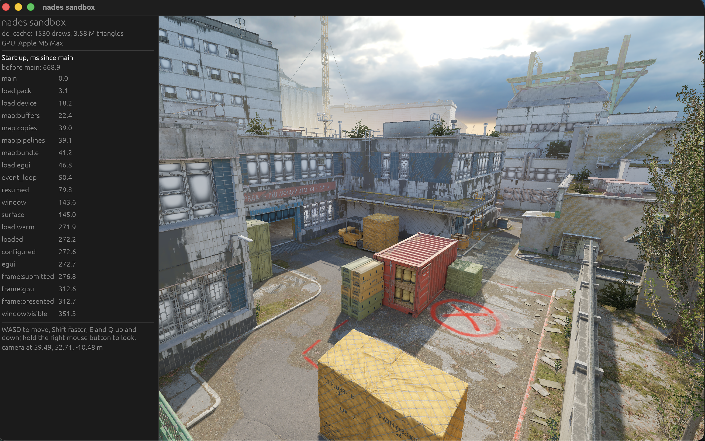

# nades-sandbox

A native CS2 map viewer built in Rust with wgpu. This first public preview renders maps with their materials,
baked lighting, sky, fog and post-processing, with a fly camera and offscreen rendering from CS2 console cameras.



## Status

**M4 (version 0.1.0).** Tested on Apple Silicon macOS. The renderer is working. Since M3 the window
is a lineup sandbox: the lineups of the throws in your data, each seen from the thrower's eye, zoomed on the aim
point, from an opponent's eye or orbiting it, with the flight, smoke, fire, flash or HE, a time scrubber and the
practice command to copy. Since M4 every pool map stays on the GPU within a memory budget, so picking another map
shows it in the next frame, and `just bundle` makes a macOS app. The workspace type-checks for Windows
(`just check-windows`) but has not been run there; Linux is not verified.

The throws come from **`cs2-throws` files**: one SQLite file of what CS2 demos record about grenade throws, named
after the game's own properties and events ([the format](docs/standalone-api.md#3-the-facts-cs2-throws-version-1)).
Any parser can write one: `tools/cs2_throws.py` is a reference writer that needs only Python's standard library, and
`show-me-the-nades` (a separate project for CS2 demo analytics) exports its database with
`nades export --cs2-throws`. Everything computed from those facts (lineup grouping, technique, practice commands,
round time, landing callouts, the opponent's viewpoints) is the sandbox's own rule, the same for every file
(`crates/model`). A producer's own labels travel as tags, shown and filterable but never interpreted.

This preview requires locally prepared CS2 assets. It contains no game files or map packs. The map preparation
pipeline currently lives in the separate, unpublished `show-me-the-nades` project, so a fresh clone builds and tests
on its own but does not provide the inputs needed to render a map. [Asset setup](docs/setup.md) describes the required
layout and overrides.

[The specification](SPEC.md) records the milestones and historical performance measurements;
[the decision log](docs/decisions.md) records the architecture and rendering evidence.

## Build and run

Install Rust 1.95 or newer and the Xcode Command Line Tools on macOS. [just](https://just.systems/) is optional;
Python 3 is needed for the tests' fixture writer and the startup benchmarks, and [uv](https://docs.astral.sh/uv/) for
the rendering comparison script. The first build compiles bundled SQLite. The repository builds on its own.

```sh
cargo build --release
cargo test --release --workspace
cargo clippy --release --workspace --all-targets

# After preparing the local inputs described in docs/setup.md:
./target/release/nades-pack de_cache
./target/release/nades-sandbox --map de_cache --data throws.sqlite
```

`--data` names a cs2-throws file or a folder of them (repeatable; a demo in two files is taken once). Without it the
sandbox reads `NADES_SANDBOX_DATA`, then `[data] paths` in `config.toml` in the platform's config folder
(`~/Library/Application Support/io.github.nu-sync.nades-sandbox/` on macOS), then the demo reader's cache folder,
which stays empty until that reader lands. Check what a file allows before opening it:

```sh
./target/release/nades-sandbox check throws.sqlite    # the file's problems, and each feature: on, off, or what fact it lacks
python3 tools/cs2_throws.py fixture /tmp/fixture.sqlite   # a small worked example of the format
```

Pick a lineup on the left; the arrow keys step through them, 1–4 pick the Lineup, Aim, Result and Orbit views, space
plays the time, and dragging turns the orbit. WASD, E/Q and the right mouse button fly a free camera.

With just installed:

```sh
just                       # list commands
just pack de_cache
just run de_cache
just check                 # justfile formatting, workspace tests and Clippy
just test-local            # ignored tests against local game files, exports and packs
just startup               # startup, steady frames and memory
just bundle                # the macOS app: target/release/bundle/macos/Nades Sandbox.app
just check-windows         # type-check and lint for Windows (DX12) from a Mac
```

The app opens the other packed maps in the background once its first frame is on screen, as long as they fit an 8 GiB budget
(less on machines with less memory; `--budget-mb` sets it). `python3 bench/resident.py` measures map switches and
memory with every map in one session.

Render one frame from a CS2 console camera or a throw's view, or print the startup stages:

```sh
./target/release/nades-sandbox --render shot.png --map de_dust2 --setpos 1,2,3 --setang 0,90
./target/release/nades-sandbox --render smoke.png --throw <throw id> --view result --time 4 --data throws.sqlite
./target/release/nades-sandbox --exit-after-first-frame
```

Check the views and the effects against show-me-the-nades' web view. Both read a clone of its database, the sandbox
through the clone's cs2-throws export; the checkout is named, never assumed:

```sh
python3 bench/cameras.py --nades <show-me-the-nades checkout>   # every view's camera for 84 throws, against the web view's own choice
uv run bench/effects.py --nades <show-me-the-nades checkout>    # result shots of chosen throws beside the web view's
cargo run --release -p nades-source-file --example tag_parity -- <export> nades   # the sandbox's groups, techniques and callouts against the file's nades.* tags
```

`python3 bench/startup.py` records load averages and stage marks, discards the first launch, and reports the
median of nine measured launches. Performance depends on the machine, system load and prepared assets.
`uv run bench/realism.py --nades <checkout> --note "what changed"` additionally requires that project's private local
reference set and web-view runs. Those reference images and generated comparison outputs are not published.

## Agent control

Build with `just build`, then configure an MCP client to run the absolute path to
`target/release/nades-mcp` with stdio transport. The server starts its sibling sandbox binary directly.
`just mcp` is the development entry point; `just verify-mcp` exercises the actual server and app.

Start with `app_status` and `maps_list`, then use `app_start`, `camera_set` and `frame_capture`.
`view_render` takes a headless screenshot without changing the visible window. `diagnostics_get` exposes startup
stages, CPU submission metrics, measured memory and recent logs. Images identify the map, camera, dimensions and
animation time; live captures also identify the instance, revision and frame.
Map changes restart the managed window. Disconnecting MCP hands a ready window to you; a future session starts its
own instance. Manually opened windows are never controlled.
Logs and private view state live in `~/.cache/nades/sandbox/mcp` by default. `--runs-dir`, `--packs-dir` and
`--sandbox-binary` provide explicit development overrides. Headless rendering currently covers the base map;
M3 throw/effect rendering is a later extension of that shared camera and image contract.

The [MCP specification](docs/mcp-spec.md) defines each tool and its success criteria. The
[verification skill](.agents/skills/verify-mcp/SKILL.md) describes repeatable local acceptance.

## Layout

| Path | Role |
|---|---|
| `crates/sandbox` | window, the lineup shell, the views, startup clock |
| `crates/control` | shared camera, scene state and application command contracts |
| `crates/mcp` | nine agent tools, managed processes and real protocol verification |
| `crates/render` | GPU renderer, materials, lighting, post-processing and console cameras |
| `crates/pack` | per-map pack format, writer and memory-mapped reader |
| `crates/source2` | VTEX textures and VPK archives |
| `crates/packer` | builds a map pack from local exports and game files |
| `crates/model` | the sandbox's vocabulary and rules: CS2's facts, the `ThrowSource` port, grouping, technique, practice commands, round time, callouts, viewpoints, the smoke's voxel-log decoder, and `Library` |
| `crates/source-file` | the `cs2-throws` file adapter: version 1 SQLite files, several merged into one source, and `check` |
| `crates/scene` | a throw as a stage: CS2's cameras, the result shot through awpy's collider, the smoke's cloud and light, the fire |
| `tools/cs2_throws.py` | the format's schema and a reference writer, Python's standard library only |
| `bench/` | benchmark camera, startup timing and rendering comparisons |
| `SPEC.md`, `docs/` | plan, setup and design evidence |

Historical engine experiments mentioned in the design documents remain local under `prototypes/` and are not
included in this preview. The production workspace contains the chosen implementation.

## License

The project's source code is [MIT licensed](LICENSE). CS2 game assets are not included or covered by that
license. Game files, exports, packs and data files stay local. The screenshot above is rendered output
from this application. This is an independent project, unaffiliated with Valve.
